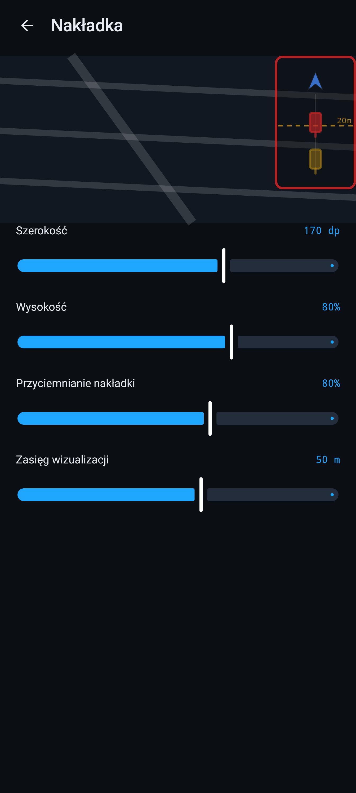
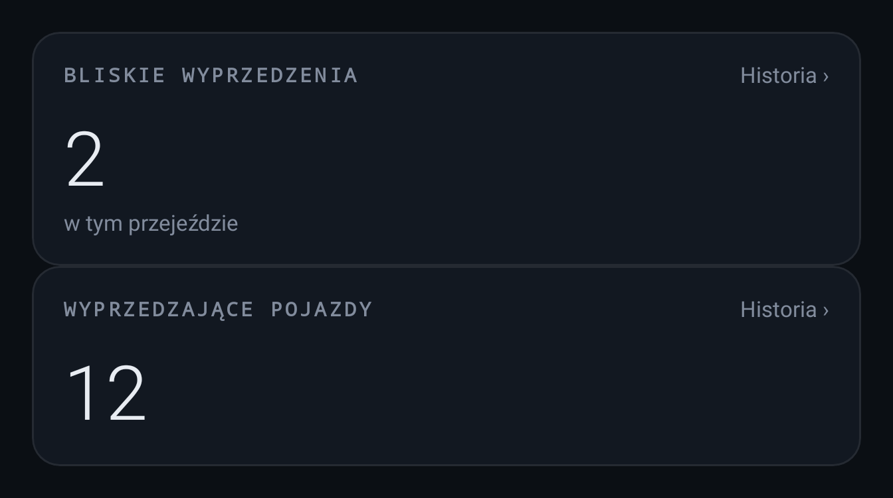

# Zrzuty nowych funkcji BikeRadar-Kross

## 1.12.2.k5

Zrzuty pokazują polski interfejs aplikacji na przykładowych danych.

### Ustawienia nakładki

Podgląd pokazuje ustawienia szerokości, wysokości, przezroczystości i zasięgu na przykładowym tle.

### Wyprzedzające pojazdy

Licznik potwierdzonych wyprzedzeń z Garmina V2 jest pod kartą bliskich wyprzedzeń. Zapisaną liczbę można też zobaczyć w historii jazdy.

 

[Lista zmian w k5](../../CHANGELOG-KROSS.md#1122k5)
